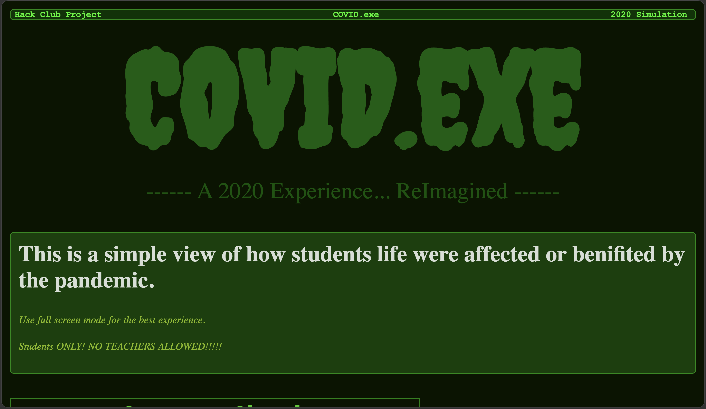
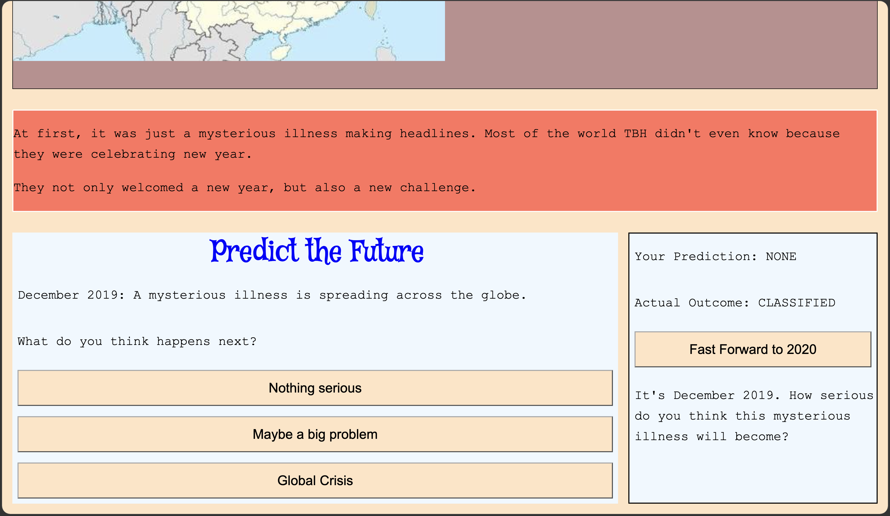
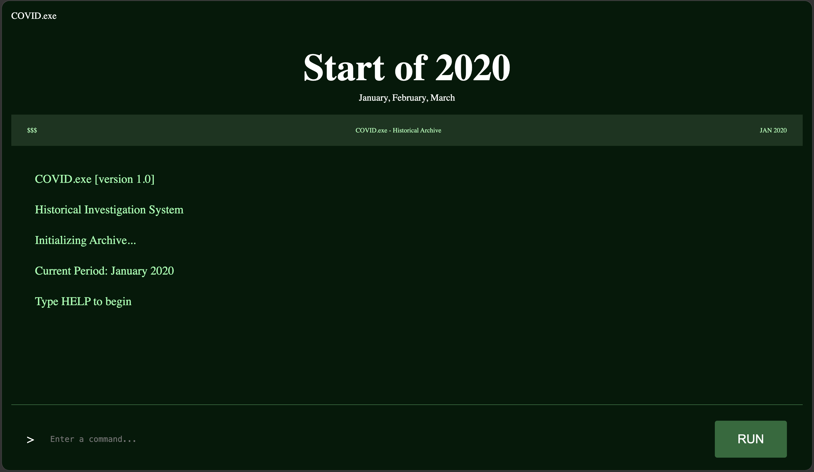
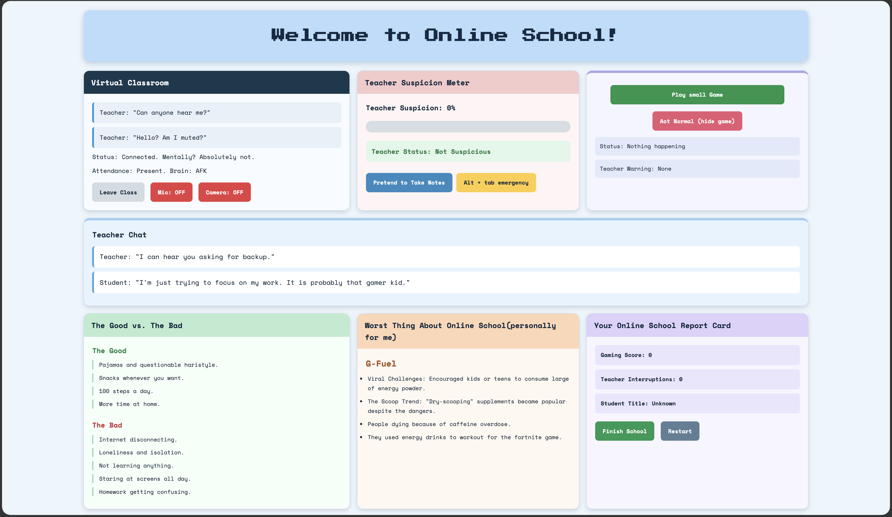

# COVID.exe

A fun, interactive trip back to 2020.

Remember when school suddenly moved into our bedrooms, teachers couldn't figure out their microphones, and everyone had an excuse for turning off their cameras?

That's what COVID.exe is all about.

I built this website to show how the pandemic changed student's lives, mixing real historical events with some funny memories of online school.

# ScreenShots

## AI declaration

I used Ai to style the last page and one of the terminal functions and that is it.

This project took me about 10 hrs to complete and was built using HTML, CSS, and JavaScript.